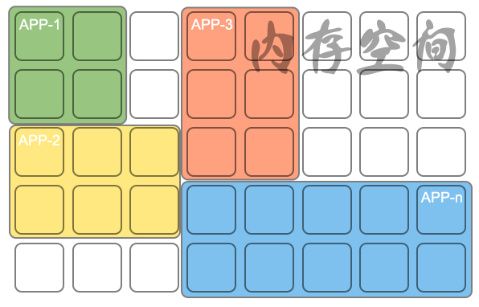
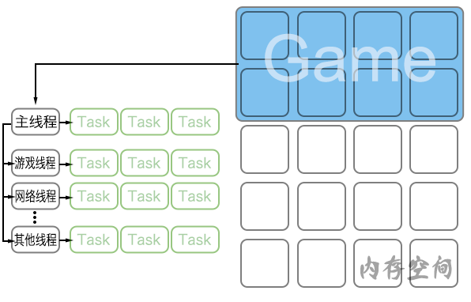
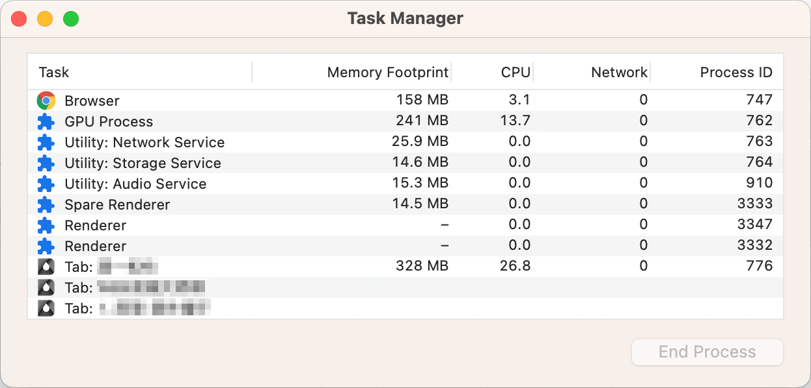
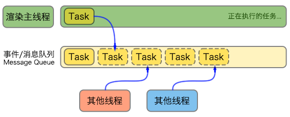

# 事件循环 Event Loop

## 浏览器模型

### 进程 process

程序运行需要自己专属的内存空间，可以把这块内存空间简单的理解为进程？

每个应用程序至少有一个进程。进程之间相互独立，即使要通信也需双方同意。

### 线程 thread, heap, stack

有了进程后，就可以运行程序的代码，运行代码的`人`称之为`线程`。

一个进程至少有一个线程，所以进程开启后会自动创建一个线程来运行代码，该线程称之为`主线程`。

如果程序需要同时执行多块代码，主线程就会启动更多的线程来执行，所以一个`进程`中可以包含多个`线程`。

> 各尽其职

### 浏览器的进程和线程

浏览器是一个多进程、多线程的应用程序。

为了避免相互影响，减少连环崩溃的几率，当启动浏览器后它会自动启动多个进程。

#### 浏览器任务管理器

Chrome

- 浏览器进程：负责界面显示，用户交互，进程管理等。浏览器进程内部会启动多个线程处理不同任务。
- 网络进程：负责加载网络资源。内部会启动多个线程处理不同网络任务。
- 渲染进程：渲染进程启动后，会开启一个主线程，主线程负责执行HTML/CSS/JS代码。默认情况下，浏览器会为每个标签页开启一个新的渲染进程，已保证不同的标签页之间不相互影响。
> 将来该默认模式可能会改变，详情见谷歌浏览器官方说明文档。

## 渲染主线程

是浏览器中最繁忙的线程，需要它处理的任务包括但不限于：

- 解析 HTML
- 解析 CSS
- 计算样式
- 布局
- 处理图层
- 每秒把页面画60次（页面刷新频率60Hz）
- 执行全局JS代码
- 执行事件处理函数
- 执行计时器等回调函数
- ...

> 为什么渲染进程不适合用多个线程来处理？

需要处理的任务之多，浏览器该如何调度？

比如：某一个函数执行到一半，用来一个用户点击事件需要处理？又或某一个计时函数又该处理了，等等。

渲染主线程：排队（任务队列）

> 无任务执行时，主线程会进入休眠状态，有新任务来时被唤醒继续执行任务。

### 何为异步

代码执行过程中，会遇到一些无法立即执行的任务，比如：

- setTimeout, setInterval
- XHR, Fetch
- addEventListener
